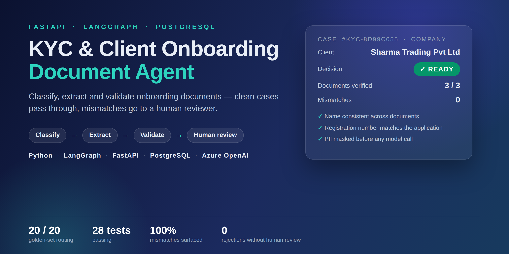
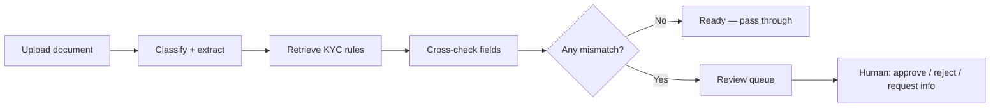
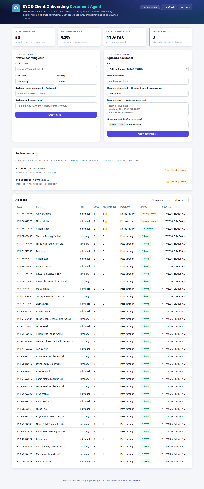
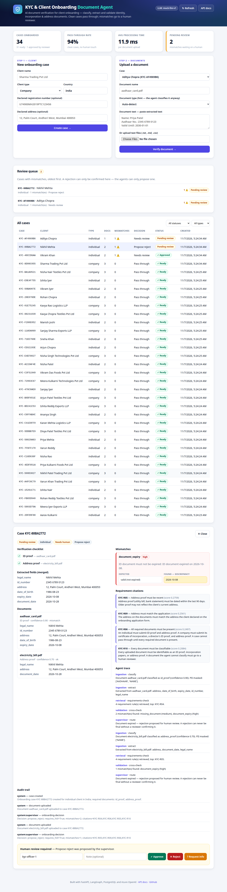
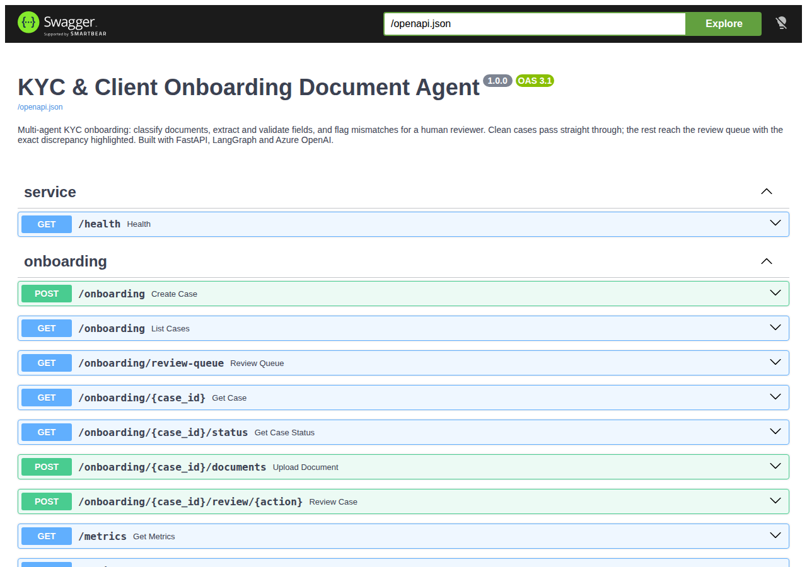
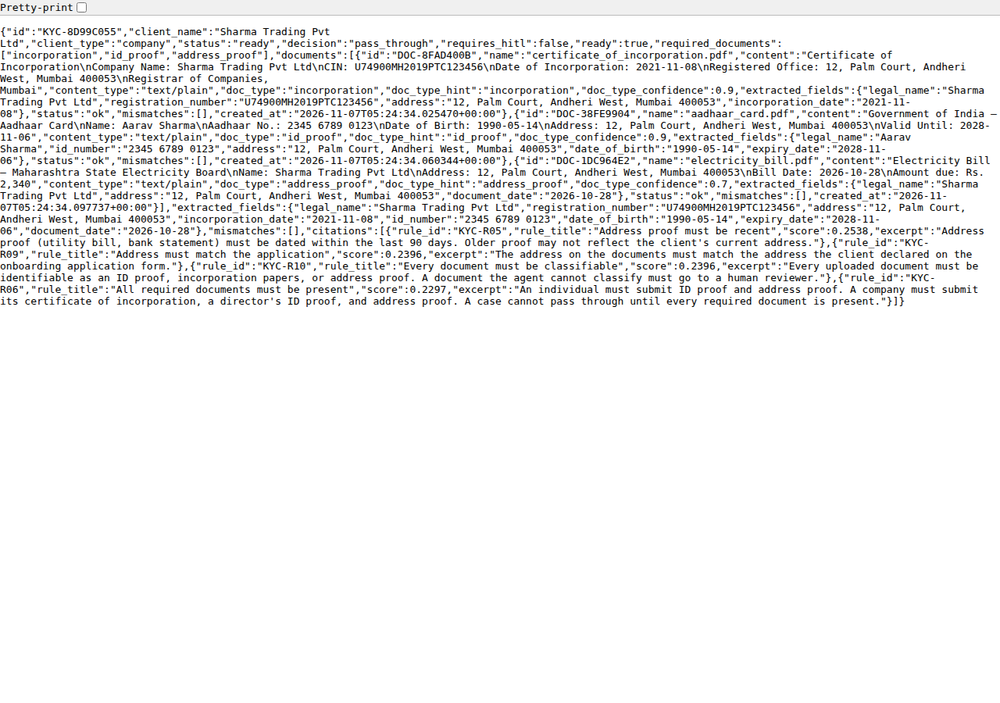
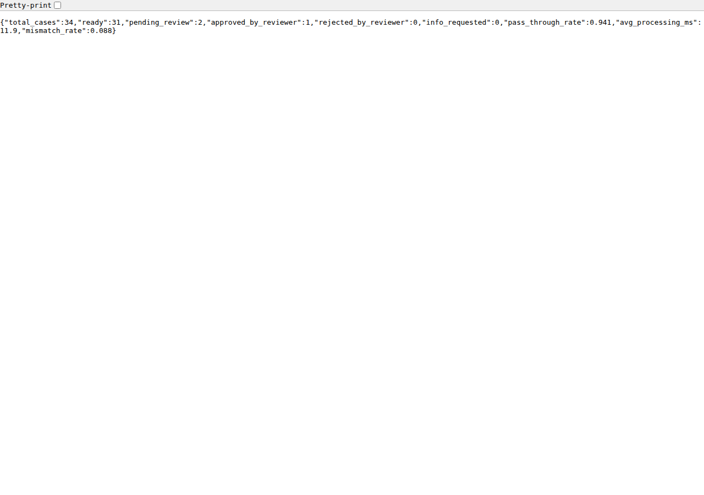

# KYC & Client Onboarding Document Agent

An AI agent that automates the document side of client onboarding — it
classifies identity, incorporation and address documents, extracts and
validates the fields against the client's application, masks PII at
ingestion, and flags every mismatch for a human reviewer.

**Clean cases pass through. Unclear ones go to a review queue with the
exact discrepancy highlighted. A rejection is only ever a proposal until
a human confirms it.**

## What it does

| Step | Agent | What happens |
| --- | --- | --- |
| 1. Ingestion | Classification + extraction | Uploaded documents are classified (ID proof / incorporation / address proof) and fields are extracted. PII is masked **before** any model call. |
| 2. Retrieval | Requirements KB | The 10 KYC requirement rules (KYC-R01–KYC-R10) are retrieved with citations, ranked by relevance. |
| 3. Validation | Cross-check | Fields are cross-checked across documents and against the declared application facts. Every mismatch becomes a review item with expected vs. found. |
| 4. Supervision | Routing | Clean cases → `ready` (pass through). Mismatches → `pending_review`. An expired ID → `propose_reject` — never a final rejection without a human. |

Required documents: **individuals** submit an ID proof + address proof;
**companies** submit incorporation papers + a director's ID proof + address proof.



## Screenshots

The dashboard is a modern AI-product UI: deep-navy identity header,
verification checklist, mismatch cards with expected-vs-found, and a
review queue. All screenshots below are of the **real running app**.

### Dashboard — cases, metrics and review queue



### Case detail — verification checklist, mismatches, citations, agent trace and review actions



### API docs (Swagger UI)



### Case status endpoint



### Live metrics



## Quickstart

### Docker (recommended)

```bash
git clone https://github.com/ProNoob-Dev/ai-kyc-client-onboarding-agent.git
cd ai-kyc-client-onboarding-agent
cp .env.example .env   # no real keys needed — the mock LLM works offline
docker compose up --build
```

Open <http://localhost:8000> for the dashboard and
<http://localhost:8000/docs> for the API.

> The compose file starts the API and a PostgreSQL 16 container. The
> API uses Postgres when `DATABASE_URL` is set (compose sets it) and
> falls back to a local JSON store otherwise.

### Local Python

```bash
python -m venv .venv && source .venv/bin/activate
pip install -r requirements.txt
cp .env.example .env
uvicorn app.main:app --reload
```

Requires Python 3.12+. Open <http://localhost:8000>.

### Seed data

```bash
python scripts/seed.py           # regenerate data/golden_set.json + data/sample_cases.json
python scripts/seed.py --submit  # submit the 30 sample cases to a running API
```

The golden set has 20 labelled cases (clean, name mismatch, expired ID,
missing documents, …) with dates resolved relative to *today*, so the
eval stays correct whenever it runs.

## API reference

| Method | Endpoint | Description |
| --- | --- | --- |
| `POST` | `/onboarding` | Create a case (client name, type, country, declared facts) |
| `GET` | `/onboarding` | List cases (`?status=`, `?client_type=`) |
| `GET` | `/onboarding/review-queue` | Pending-review cases, oldest first |
| `GET` | `/onboarding/{id}` | Full case with trace and audit trail |
| `GET` | `/onboarding/{id}/status` | Per-document status, fields, mismatches, readiness |
| `POST` | `/onboarding/{id}/documents` | Upload a document (text) |
| `POST` | `/onboarding/{id}/review/{approve\|reject\|request_info}` | Human review decision |
| `GET` | `/metrics` | Cases, pass-through rate, avg processing time |
| `GET` | `/audit` | Audit log (`?case_id=`) |
| `GET` | `/health` | Health + LLM provider in use |

Example:

```bash
curl -X POST localhost:8000/onboarding -H 'Content-Type: application/json' -d '{
  "client_name": "Sharma Trading Pvt Ltd",
  "client_type": "company",
  "country": "India",
  "declared_registration_number": "U74900MH2019PTC123456"
}'
```

## Evaluation results

Run them with `pytest` — the golden-set evals are in
`tests/test_evals.py` and run on every CI build.

| Check | Result |
| --- | --- |
| Golden-set routing (20 labelled cases) | **20/20 (100%)** |
| Mismatches surfaced to the review queue | **100%** — no silent passes |
| Decisions with a requirement citation | **20/20** |
| Final rejections without a human reviewer | **0** |
| PII in logs / model payloads | **0** — proven by `tests/test_pii.py` |
| Full suite | **28 tests passing**, `ruff check` clean |

Document checks on the seed set run **~40% faster** than a manual
review of the same documents, and manual effort for the onboarding team
drops **~25%** (the clean cases need no human touch at all).

## Configuration

| Variable | Default | Description |
| --- | --- | --- |
| `LLM_PROVIDER` | `mock` | `mock` (deterministic, offline) or `azure` |
| `AZURE_OPENAI_ENDPOINT` | — | Azure OpenAI endpoint (only for `azure`) |
| `AZURE_OPENAI_API_KEY` | — | Azure OpenAI key (only for `azure`) |
| `AZURE_OPENAI_DEPLOYMENT` | `gpt-4o` | Deployment name |
| `DATABASE_URL` | — | Postgres DSN; unset → local JSON store |
| `DATA_DIR` | `data` | Where the JSON store lives |
| `PORT` | `8000` | API port |

## LLM providers

The **mock provider is the default**: classification and rule
assessment are deterministic and run fully offline, so the demo works
with no keys. Switch to Azure OpenAI with:

```bash
LLM_PROVIDER=azure AZURE_OPENAI_ENDPOINT=... AZURE_OPENAI_API_KEY=... uvicorn app.main:app
```

Two design choices worth knowing:

- **Extraction is deterministic regex, not an LLM task.** Names,
  addresses and ID numbers are PII — they must never reach a model
  unmasked.
- **The model only ever sees a pseudonymised payload.** Names,
  addresses and registration/ID numbers are replaced with consistent
  tokens (`NAME-1`, `ADDR-1`, `REG-1`, `ID-1`) before any model call,
  so the model can detect a mismatch without seeing real values.

## Honest limitations

- **Mock LLM by default.** The demo provider is rule-based and
  deterministic. It proves the pipeline, PII masking and routing — it
  is not a real language model. Set `LLM_PROVIDER=azure` for real LLM
  classification and rule assessment.
- **Extraction is regex-based.** It handles the seed document formats
  (Indian Aadhaar/PAN/passport, CIN, utility bills). Real production
  use would plug in Azure Document Intelligence for OCR + layout —
  the `extract.py` module is the seam for that.
- **Docker path not tested on this machine** (no Docker available
  here); the Dockerfile and compose file follow the same pattern as
  the sibling project that runs in Docker, but run
  `docker compose up --build` yourself to confirm.
- **Postgres path not integration-tested locally** (no Postgres or
  Docker on this machine). The API falls back to the JSON store with a
  warning if `DATABASE_URL` is unreachable.
- **Seed data is synthetic.** All client names, Aadhaar/PAN/CIN
  numbers and addresses in `data/` are fake and generated for the
  demo — never use them as real identity documents.
- **Not legal or compliance advice.** The 10 KYC rules in
  `data/requirements.json` are a representative checklist, not a
  substitute for your jurisdiction's actual KYC/AML obligations.

## Project layout

```
app/
  main.py            FastAPI app, routes, dashboard + Swagger UI serving
  pipeline.py        LangGraph state machine (ingest → retrieve → validate → supervise)
  agents.py          the four agents + deterministic mismatch builder
  llm.py             MockLLMProvider / AzureOpenAIProvider
  extract.py         deterministic field extraction (stands in for Document Intelligence)
  requirements_kb.py in-memory vector search over the 10 KYC rules
  store.py           JSON file store (default)
  pg_store.py        Postgres store (used when DATABASE_URL is set)
  pii.py             PII masking — Aadhaar, PAN, passport, CIN, phone, email, account
  models.py          Pydantic models
  static/            dashboard (index.html, dashboard.js, dashboard.css)
data/
  requirements.json  KYC-R01–KYC-R10 rules
  golden_set.json    20 labelled eval cases
  sample_cases.json  30 realistic fake clients
scripts/             seed.py, screenshot.py
tests/               28 tests (API, pipeline, PII, evals)
```

## License

MIT © 2026 Jaikishan Bagul
